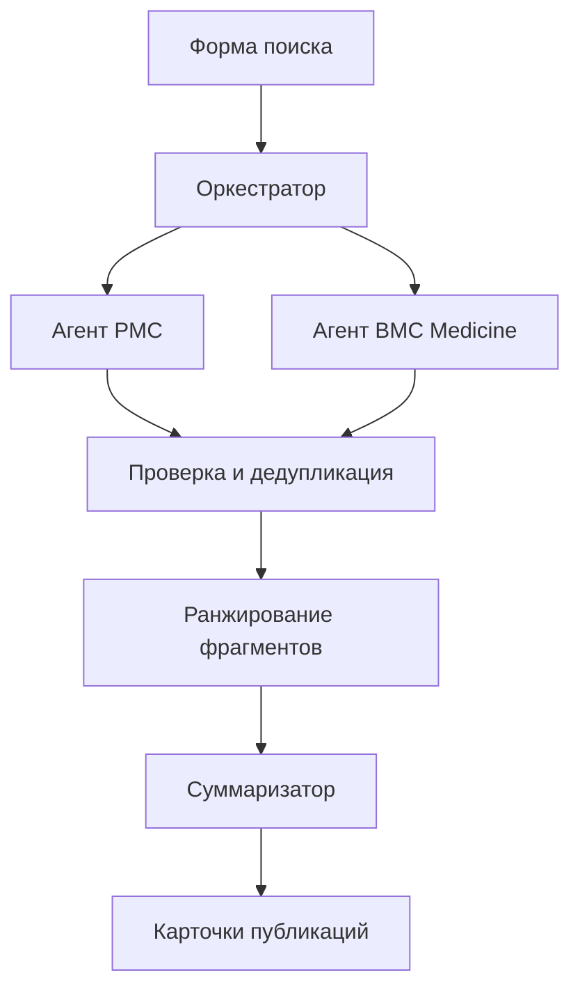

# Поиск медицинских публикаций

Приложение Streamlit параллельно ищет литературу в PubMed Central и журнале BMC Medicine. Пользователь задаёт английские ключевые слова, период и число записей на источник. Приложение проверяет релевантность, объединяет повторные записи, показывает фрагменты аннотаций и ссылки на статьи. Журнал агентов показывает результаты, длительность и ошибки этапов. Результат можно выгрузить в JSON.

## Быстрый запуск

Для Python 3.12 выполните из корня репозитория:

    python -m venv .venv
    # PowerShell
    .venv\Scripts\Activate.ps1
    # Linux / macOS
    source .venv/bin/activate
    python -m pip install -r requirements.txt
    python -m streamlit run app.py

Для первого поиска оставьте запрос **sleep duration hypertension**, оба источника и период с 2018 года. Для поиска нужен доступ к публичным API. Ключи для поиска и показа фрагментов не требуются.

## Streamlit Community Cloud

В [Streamlit Community Cloud](https://share.streamlit.io/) выберите **Create app** и укажите:

| Поле | Значение |
| --- | --- |
| Repository | TheAlexGlow/PIMIIM_rag_from_2_sources |
| Branch | main |
| Main file path | app.py |
| Python | 3.12 в Advanced settings |

Нажмите **Deploy**. Streamlit установит зависимости из requirements.txt.

Русскоязычная сводка через OpenAI включается по желанию. Добавьте нужные переменные в **Advanced settings → Secrets** или в локальный .streamlit/secrets.toml:

    OPENAI_API_KEY = "..."
    OPENAI_MODEL = "gpt-4.1-mini"
    LITERATURE_CONTACT_EMAIL = "..."
    NCBI_API_KEY = "..."

Все переменные необязательны. Для режима OpenAI нужен OPENAI_API_KEY, модель по умолчанию — gpt-4.1-mini. При включении этого режима вопрос и выбранные фрагменты передаются OpenAI. Секреты можно задать и через переменные окружения.

## Архитектура по курсу

За основу взят практикум **«Базовые паттерны МАС»** из курса «Программная инженерия мультиагентных систем в клинической медицине». Он задаёт цикл из сбора записей, проверки темы, суммаризации и возврата карточек в Streamlit. Поисковые адаптеры заменены на PMC и BMC Medicine, а независимые вызовы выполняются параллельно по лекции 3.

| Материал | Реализация |
| --- | --- |
| [Лекция 3, конвейер](https://edwfa.github.io/mas-lecture/lecture/03/slide-03.html) и [практикум](https://edwfa.github.io/mas-lecture/lecture/practicum/patterns.html) | Маршрутизатор формирует SearchPlan. Агенты возвращают SourceResult, валидатор и суммаризатор принимают типизированные результаты предыдущих шагов. |
| [Лекция 3, маршрутизация](https://edwfa.github.io/mas-lecture/lecture/03/slide-07.html) и [параллельное выполнение](https://edwfa.github.io/mas-lecture/lecture/03/slide-10.html) | Оркестратор выбирает адаптеры из списка источников. Поиск запускается в ThreadPoolExecutor. Валидатор ждёт ответы всех выбранных агентов. Сбой одного источника сохраняет результаты другого. |
| [Лекция 3, рефлексия](https://edwfa.github.io/mas-lecture/lecture/03/slide-14.html) | В режиме OpenAI проверяются ID и совпадение дословной цитаты. При ошибке формата или цитирования суммаризатор получает обратную связь и повторяет попытку один раз. |
| [Лекция 4, внешние инструменты](https://edwfa.github.io/mas-lecture/lecture/04/slide-03.html) | Источники доступны через отдельные адаптеры к HTTP API. |
| [Лекция 5, состояние сессии](https://edwfa.github.io/mas-lecture/lecture/05/slide-12.html) | Последний отчёт хранится в st.session_state и остаётся доступным при переключениях интерфейса в текущей сессии. |

Материалы курса доступны в [зеркале лекций](https://edwfa.github.io/mas-lecture/) и [репозитории практикума](https://github.com/EdwFa/MAS/tree/main/Лекция_3).

## Источники и обработка

- **PMC**. Поиск через NCBI ESearch и извлечение метаданных и аннотаций из JATS через EFetch. Поиск ограничен лицензиями CC BY и CC0. [NCBI E-utilities](https://www.ncbi.nlm.nih.gov/books/NBK25497/) · [Фильтры лицензий PMC](https://pmc.ncbi.nlm.nih.gov/tools/articles-by-license/)
- **BMC Medicine**. Поиск по записям журнала в Crossref (ISSN 1741-7015). Europe PMC дополняет отсутствующие аннотации по DOI и служит резервным поисковым API для того же журнала. Ссылки ведут к опубликованным статьям. [Crossref REST API](https://www.crossref.org/documentation/retrieve-metadata/rest-api/) · [Europe PMC REST API](https://europepmc.org/RestfulWebService) · [BMC Medicine](https://link.springer.com/journal/12916)
- **Валидация**. Все значимые слова должны встретиться в названии или аннотации, с простой нормализацией множественного числа. DOI и PMCID используются для дедупликации. Если статья найдена по обоим каналам, обе ссылки сохраняются.
- **Сводка**. BM25 ранжирует предложения аннотаций. От каждого документа берётся один фрагмент. Без OpenAI выводятся исходные фрагменты. В режиме RAG модель получает до восьми фрагментов и возвращает выводы с привязкой к цитатам. Программная проверка подтверждает присутствие цитат. Смысловую корректность парафраза можно сверить по показанному фрагменту.
- **Границы**. Поиск обрабатывает первые N записей каждого источника и использует аннотации. Строгая лексическая проверка может пропустить статьи с синонимами. Результат предназначен для навигации по литературе, клинические решения требуют проверки первоисточников.

## Проверка

    python -m unittest discover -s tests -v

Тесты используют локальные ответы API и прогоняют форму Streamlit через AppTest. Для ручной проверки после деплоя выполните пример поиска и убедитесь, что оба агента отработали и карточки ведут к исходным статьям.
